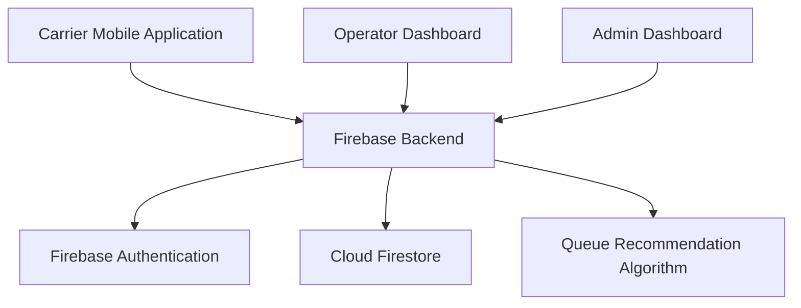

# 🚛 Arrivio – Smart Queue Recommendation System

Arrivio is a logistics and transportation management system designed to reduce truck congestion, optimize queue management, and improve operational efficiency at logistics facilities.

The system uses an M/M/1 queuing model to estimate waiting times and recommend suitable service stations, enabling data-driven decision-making.

## 🎯 Project Objectives

- Reduce truck waiting times and facility congestion.
- Optimize service station selection.
- Improve logistics operations through real-time queue management.
- Provide effective communication between carriers, operators, and administrators.
- Support data-driven operational decisions.

## ✨ Key Features

### Carrier Mobile Application

- Secure authentication
- Smart station recommendations
- Estimated waiting time calculation
- Time slot selection and booking
- Real-time queue tracking
- Duplicate booking prevention
- Issue reporting

### Operator Dashboard

- Real-time queue monitoring
- Carrier and booking information
- Queue status management
- Service initiation and completion
- No-show management
- Facility status monitoring

### Admin Dashboard

- User and role management
- Account approval and rejection
- Station performance monitoring
- Queue statistics and analytics
- Service station management
- Issue resolution

## 🛠️ Technology Stack

| Technology | Purpose |
|------------|---------|
| React Native | Mobile application |
| Expo | Mobile development environment |
| HTML, CSS, JavaScript | Web dashboards |
| Node.js | Backend development |
| Firebase Cloud Functions | Backend business logic |
| Firebase Authentication | Authentication and authorization |
| Cloud Firestore | Real-time NoSQL database |
| Git & GitHub | Version control |

## 🧠 Queue Recommendation Algorithm

Arrivio implements the M/M/1 queuing model to estimate station performance and recommend suitable service stations.

The recommendation mechanism considers:

- Arrival rate (λ)
- Service rate (μ)
- Station utilization (ρ)
- Estimated waiting time
- Queue conditions

Station utilization:

ρ = λ / μ

Expected waiting time in the queue:

Wq = λ / [μ(μ − λ)]

These steady-state calculations assume λ < μ.

The system uses estimated waiting times to rank available stations and support more efficient booking decisions.

## 🏗️ System Architecture



## 🔐 Security and Data Management

- Role-based access control
- Secure user authentication
- Booking validation
- Duplicate booking prevention
- Queue state transition validation
- Real-time database synchronization

## 🚀 Getting Started

### Clone the Repository

```bash
git clone https://github.com/cengizdemiray/arrivio.git
cd arrivio
```

### Web Application

Start the web application using the project's configured development server.

Local development address:

http://localhost:3000

### Mobile Application

Navigate to the mobile application directory and run:

```bash
npm install
npx expo start
```

Use Expo Go to run the application on a mobile device.

### Firebase Configuration

Configure your Firebase project and the required environment variables before running the application.

Do not commit private credentials or service account keys to the repository.

## 🧪 Testing Strategy

- Unit testing
- Integration testing
- System testing
- Performance testing
- Usability testing
- Firebase security rules testing

## 📚 Software Engineering Practices

- Requirements analysis
- System design and modeling
- Agile development
- Version control
- Software testing
- Technical documentation
- Team collaboration

## 👥 Project Team

- Cengiz Demiray
- Nağme Çağla Gölcü
- Fatih
- Alpdoğan

## 🎓 Academic Background

This project was developed as a Computer Engineering Capstone Project at Middle East Technical University Northern Cyprus Campus (METU NCC).

## 🔗 Original Repository

[Arrivio – Original Project Repository](https://github.com/cengizdemiray/arrivio)

## 📌 Project Vision

Arrivio aims to transform traditional logistics queue management into a smarter, more transparent, and data-driven process by combining mathematical modeling with modern software technologies.
